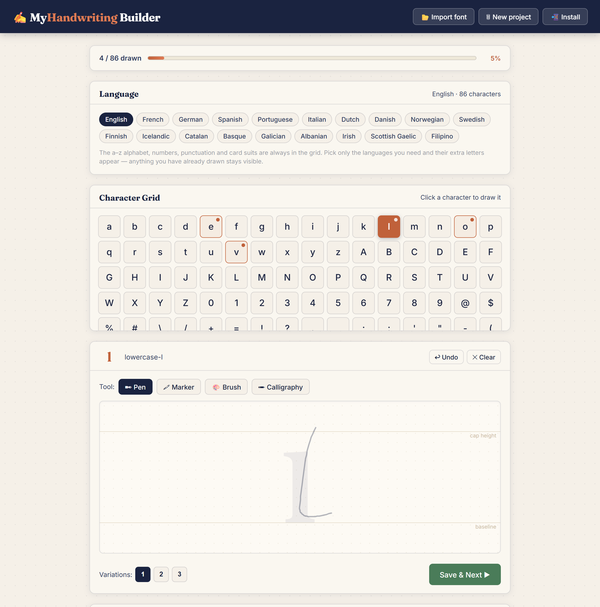
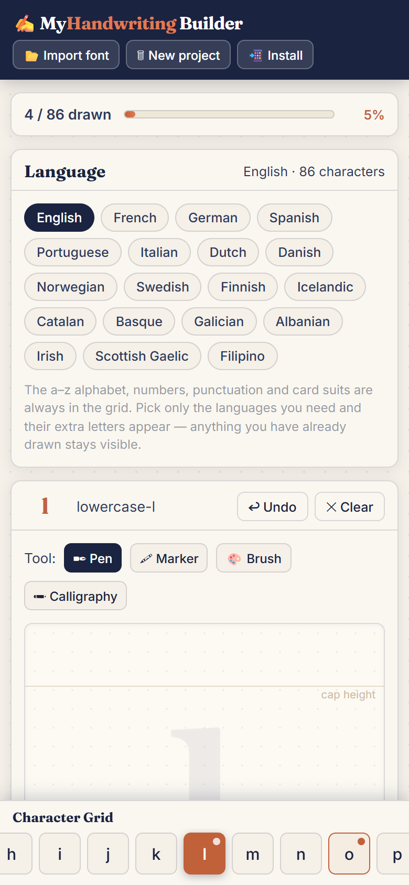

# ✍ MyHandwriting Builder

Draw every character of a font by hand and export a real **OTF or TTF** file — with letter variations, ligatures and your own letter spacing. Everything runs in the browser; nothing is uploaded anywhere.

**[Try it live → custom-font-generator.netlify.app](https://custom-font-generator.netlify.app/)**



## What it does

Pick the languages you write in, draw each character on a guided canvas, then download a font you can install on your computer, use in Word or Figma, or embed on a website. The exported fonts are real fonts with real OpenType tables — not a canvas trick.

## Features

**Drawing**
- Four tools with different stroke behaviour: **Pen**, **Marker**, **Brush** (thick when slow, thin when fast) and **Calligraphy** (a fixed nib angle).
- Faint cap-height and baseline guides plus a ghost of the character you are drawing.
- Undo, clear, and up to **three variations per character** — the extra forms are swapped in while writing so the same letter never looks repeated.
- Draw a character once and the export still generates two gently re-tilted forms for variety.

**Typography**
- **Ligatures**: add a sequence such as `th` or `ll`, draw it joined as one unit, and it becomes an OpenType `liga` ligature.
- Letter variations become `calt` (contextual alternates) rules.
- A global **letter spacing** slider, with a live preview as you move it.
- Live preview with a **Shuffle** button to re-randomise variants.

**Workflow**
- 19 languages: pick only the ones you need and their extra accented letters appear in the grid.
- Autosave to `localStorage`, so closing the tab never loses your work. **New project** clears it.
- **Import** an existing `.otf` / `.ttf` to bring its glyph outlines into the editor as a starting point.
- Installable PWA with an offline cache, and a phone layout that keeps the alphabet pinned to the bottom of the screen.

**Privacy**
- 100% client-side. No accounts, no uploads, no analytics — your drawings never leave the device.

## Quick start

1. Open [the live app](https://custom-font-generator.netlify.app/) (or run it locally — see below).
2. Tick the languages you want under **Language**.
3. Click a character, draw it between the cap-height and baseline guides, then hit **Save & Next**.
4. Optionally add ligatures and tune the **Letter spacing** while watching the preview.
5. Choose **OTF** or **TTF** and click **Download**.

A useful tip: you do not need all 86 characters to get something usable — draw the letters you actually type in and export. Undrawn characters fall back to the `.notdef` box.

## Character set

- `a–z`, `A–Z`, `0–9`
- punctuation and symbols: `@ $ % # \ / + = ! ? . , ; : ' " - ( ) _`
- card suits: `♥ ♦ ♣ ♠`
- accented letters for **English, French, German, Spanish, Portuguese, Italian, Dutch, Danish, Norwegian, Swedish, Finnish, Icelandic, Catalan, Basque, Galician, Albanian, Irish, Scottish Gaelic** and **Filipino**

Only the languages you select add cells to the grid, and any character you have already drawn stays visible when you switch languages off.

## Run it locally

It is a static site with no build step:

```bash
python -m http.server 8000
# then open http://localhost:8000
```

Opening `index.html` directly works too, but serving it over `http://` is what enables the service worker and the **Install** button.

```
index.html              the whole app (markup, styles, logic)
manifest.webmanifest    PWA metadata
sw.js                   offline cache
icon-*.png              app icons
docs/                   README screenshots
```

## How it works

- **One file, vanilla JS.** No framework, no bundler. [opentype.js](https://opentype.js.org/) is loaded from a CDN and writes the CFF-flavoured `.otf`.
- **OTF and TTF.** opentype.js only writes CFF, so the `.ttf` build is assembled in the page: cubic outlines are converted to quadratic TrueType outlines, and the layout and metadata tables are copied over so both files shape and space identically.
- **OpenType layout is written by hand.** `liga` lookups rewrite drawn ligature sequences; `calt` lookups step each letter through its variations based on the preceding glyph. Alternates live at private-use codepoints internally so the preview can address them directly.
- **No server.** Stroke data lives in `localStorage`; the font blob is generated in memory on download.

## Screenshot



## Built with

Vanilla JavaScript, Canvas 2D, opentype.js, the OpenType `GSUB` table, and the PWA manifest/service worker APIs.
